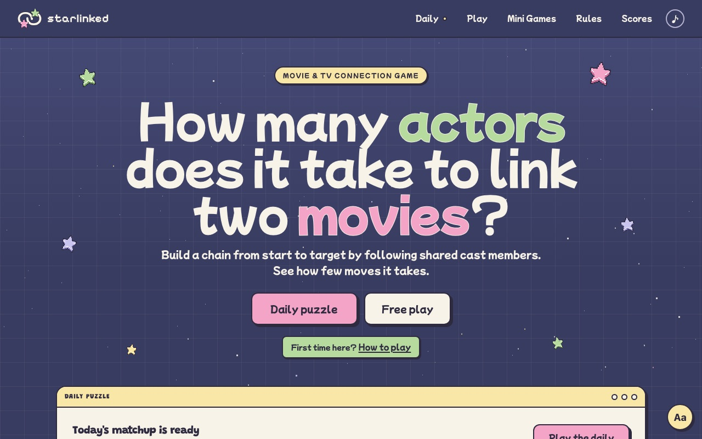
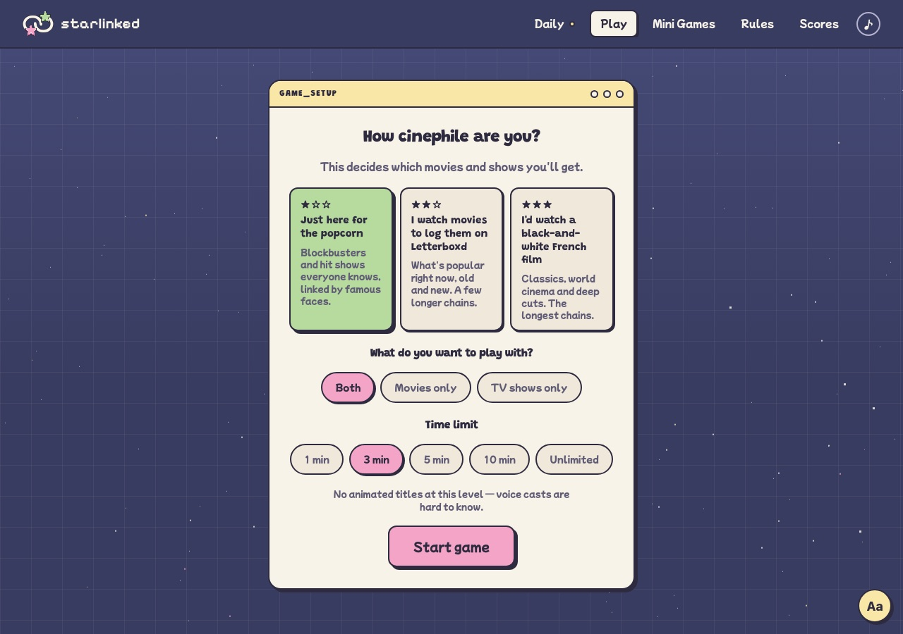
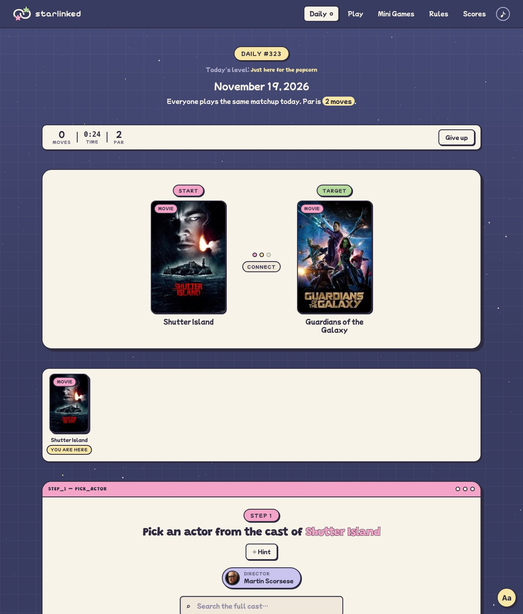
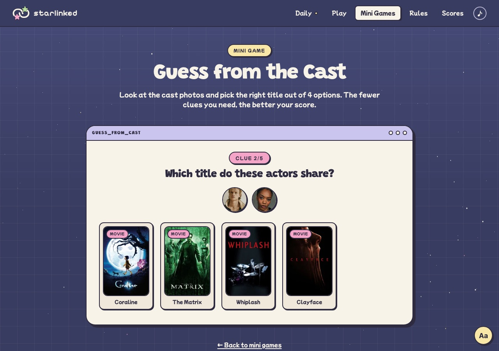
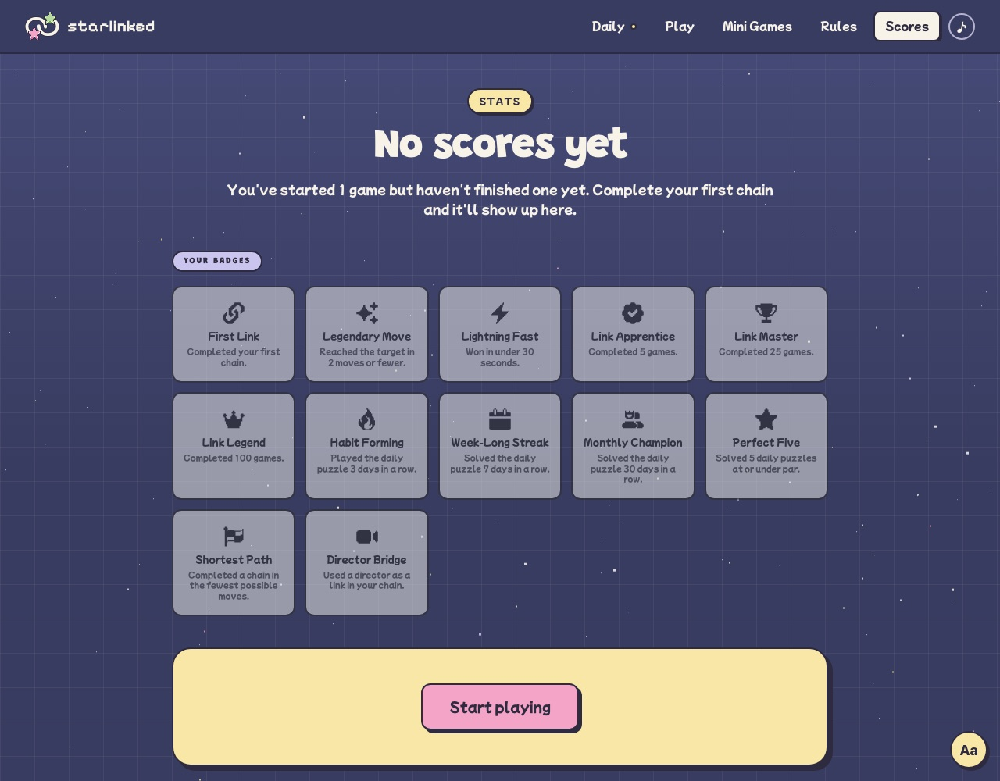
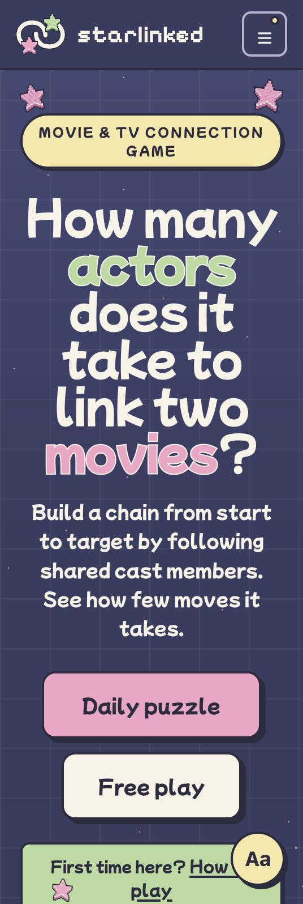
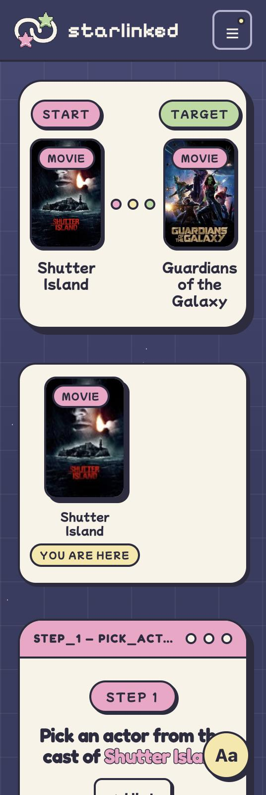
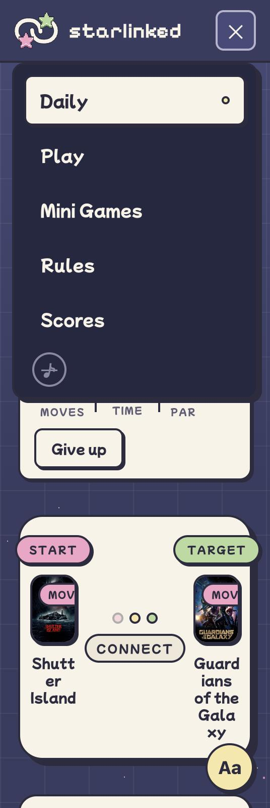
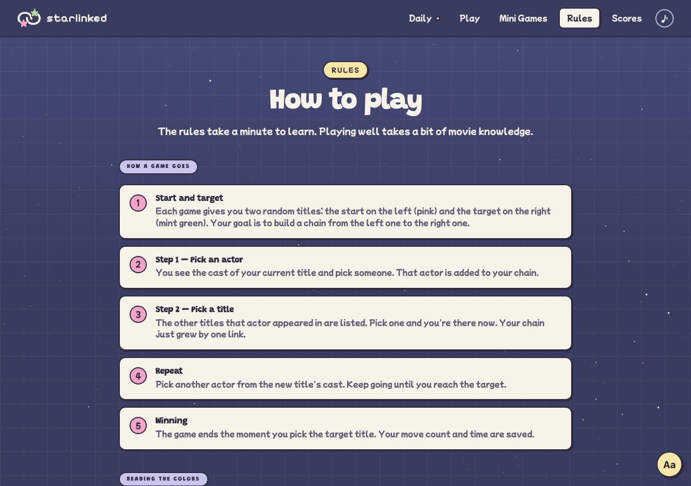

# Starlinked

**How many actors does it take to link two movies?**

Starlinked is a movie and TV connection game. You get a starting title and a target title, and you build a chain between them through shared cast members: pick an actor from the current title's cast, jump to another movie or show they were in, and keep going until you reach the target, in as few moves as you can.



## Features

- **Free play with three levels.** The setup screen asks *"How cinephile are you?"*:
  - ★☆☆ **Just here for the popcorn**: the most-voted blockbusters and hit shows, no animation, linked only through famous faces. 2–3 moves.
  - ★★☆ **I watch movies to log them on Letterboxd**: what's popular right now, old and new. 2–4 moves.
  - ★★★ **I'd watch a black-and-white French film**: classics, world cinema and deep cuts. 3–5 moves.
- **Movies, TV shows or both.** Keep a whole game to movies only or series only.
- **Optional time limit**, plus a "skip animated titles" switch for when voice casts are a mystery.
- **Daily puzzle.** One matchup for everyone each day, at a level drawn at random each day, with a par (the shortest known chain), streaks and a spoiler-free share text.
- **Hints.** Shows which actor to pick next on the shortest path, and then which title to jump to. Hints are noted on your result.
- **Full cast search.** Series list their regulars first, sorted by episode count, and search reaches the whole cast, guest stars included.
- **Guess from the Cast**, a mini game: name the title from cast photos, out of four options.
- **Badges and stats**, all stored in your browser. No account needed.

| Choosing a level | A daily puzzle in progress |
| --- | --- |
|  |  |

| Guess from the Cast | Badges |
| --- | --- |
|  |  |

It works on phones too, with the menu folded behind a ☰ button:

| Home | Daily puzzle | Menu |
| --- | --- | --- |
|  |  |  |

## How to play

1. Start a game (free play or the daily puzzle) to get a start and a target title.
2. Pick an actor (or the director) from the current title's cast.
3. Pick another movie or show that person was in. It's added to your chain.
4. Repeat until you reach the target. Fewer moves means a better score.

The full rules and strategy tips are on the in-game **Rules** page.



## How it works

- **Frontend:** React + TypeScript (Vite). Stats, badges and settings live in `localStorage`.
- **Backend:** Python + FastAPI, a thin layer over the [TMDB](https://www.themoviedb.org) API with in-memory caching.
- **Title pools and the connection graph:** for each level the backend fetches a pool of titles from TMDB and builds an in-memory graph of which titles share cast members. New games are picked from that graph, so every matchup is guaranteed to be solvable, and the same graph powers hints, the "give up" solution and the daily puzzle's par. Talk shows, reality TV and "as themselves" appearances are filtered out, since they would link almost anything.

```
backend/app/   FastAPI app: routes, TMDB client, levels, title pools, connection graph
frontend/src/  React app: pages, components, game state, local stats
frontend/scripts/make-starfield.py   generates the drifting starfield background CSS
docs/screenshots/   the images in this README
```

## Running it locally

### 1. Get a TMDB API key

Create a free account on [themoviedb.org](https://www.themoviedb.org/) and get an **API key (v3 auth)** from your account settings.

### 2. Backend

```bash
cd backend
python -m venv venv
source venv/bin/activate        # macOS / Linux
# ./venv/Scripts/Activate.ps1   # Windows PowerShell
pip install -r requirements.txt
cp .env.example .env
```

Open `.env` and set `TMDB_API_KEY` to your key. Then start the server:

```bash
uvicorn app.main:app --reload --port 8000
```

The API docs (Swagger UI) are at http://localhost:8000/docs. On startup the server builds the three level graphs in the background, smallest first. The biggest one takes around half a minute.

### 3. Frontend (in a second terminal)

```bash
cd frontend
npm install
cp .env.example .env.local
npm run dev
```

Open http://localhost:5173.

While running in dev mode, an **Aa** button in the corner opens a font playground for trying other fonts on the site. It isn't part of production builds.

## Known limitations

- Chain steps are only checked in the browser. A scoreboard or leaderboard would need a server-side check too.
- The backend keeps everything in memory. After a restart (or a free hosting plan waking up from sleep) it rebuilds the title pools before the bigger levels are playable.

## Credits

- Movie and TV data: [TMDB](https://www.themoviedb.org). This product uses the TMDB API but is not endorsed or certified by TMDB.
- Logo and title stars: based on [Pixel Art Animated Star](https://soulofkiran.itch.io/pixel-art-animated-star) by Narik, recolored. Free for personal and commercial use.
- Badge and mini game icons: [Pixel Icon Library](https://github.com/hackernoon/pixel-icon-library) by HackerNoon, licensed [CC BY 4.0](https://creativecommons.org/licenses/by/4.0/).
- Drifting starfield background: technique adapted from a [Uiverse.io](https://uiverse.io) starfield by sinful_9361 (MIT).
- Fonts: [Pixelify Sans](https://fonts.google.com/specimen/Pixelify+Sans), [Grandstander](https://fonts.google.com/specimen/Grandstander) and [Mochiy Pop One](https://fonts.google.com/specimen/Mochiy+Pop+One), from Google Fonts (SIL Open Font License).
- Click sound: from the author's portfolio site.
